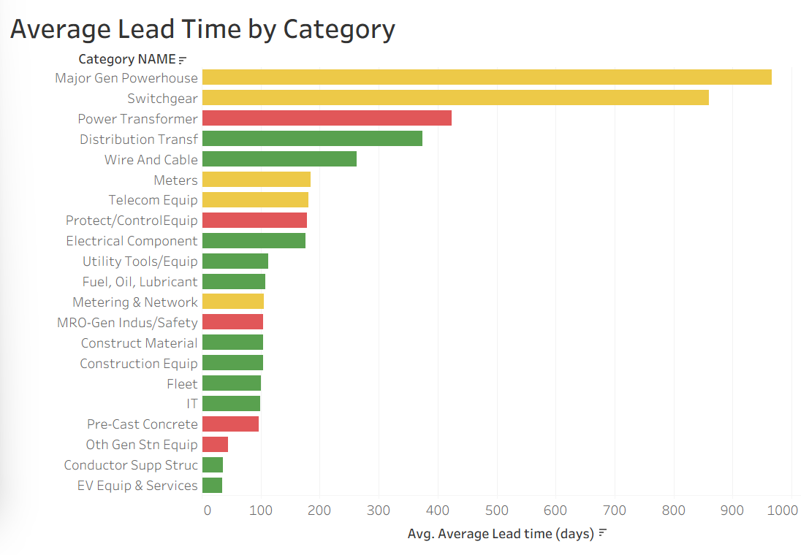

# BC Hydro Supply Chain Risk Analytics

*Beedie Business Analytics Hackathon 2025 · SFU Beedie School of Business × BC Hydro · May 2025*
*Team 9: Jane Le, Isabel Angwah, Sahiljeet Singh*

**Which equipment could BC Hydro run out of if the supply chain breaks down?** In this hackathon, my team analyzed BC Hydro's vendor and inventory data to find the equipment categories most exposed to long delivery delays and to dependence on U.S. suppliers.

## The challenge

BC Hydro delivers electricity to about 95% of British Columbia. To maintain and expand the power grid, it relies on equipment such as transformers, switchgear and meters, much of it sourced from outside the province. Tariffs, cross-border delays and supplier problems can all put that equipment at risk.

Our task was to identify which product categories are most vulnerable to disruption and to recommend how BC Hydro could reduce that risk.

## My role

I handled the data cleaning in Excel and built the Tableau dashboard visualizations. Together with my teammates, I focused on research, the written analysis and the presentation.

## Presentation
[Our final presentation to the judges (PDF)](BC_Hydro_Team9_Presentation.pdf)
**Numbers and figures came from modified data for the hackathon, not real BC Hydro's data.**

## Data

The organizers provided:
- **BC Hydro internal data** (modified for confidentiality): a list of about 3,200 vendors, a sample of 291 vendor-item records with lead times and stock levels, and annual spend and risk tolerance by category.
- **Public data:** WTO tariff rates and import values by product code, and the World Bank's Logistics Performance Index.

> The case materials and BC Hydro's data were provided for the hackathon only and can't be shared, so this repository contains my write-up and dashboard screenshots, not the data.

## What I did

1. **Cleaned and combined the data in Excel:** I put the vendor list, the inventory sample and the risk tolerance table into one workbook, and used `VLOOKUP` to bring each vendor's performance rating, portfolio, risk tolerance and annual spend into one "merged" sheet.
2. **Built two Tableau charts:**
   - **Average lead time by category:** how long each type of equipment takes to arrive after ordering
   - **Lead time vs. days of supply:** whether current stock lasts long enough to cover the wait for a new order

*How long each type of equipment takes to arrive after ordering. Colours show the category's risk tolerance*

*Each dot is a category. Dots **below the diagonal** have less stock (in days) than the time it takes to restock. The red dot at about 424 days of lead time is power transformers.*

## Key findings

1. **The biggest equipment takes the longest to replace.** Major generation powerhouse equipment takes about 966 days on average to arrive, switchgear about 860, battery energy storage about 640, and power transformers about 424. A disruption to these categories would last years, not weeks.
2.**U.S. dependence is concentrated in a few categories.** Our team found that meters and protection & control equipment came entirely from U.S. suppliers in the sample, and about half of distribution transformer suppliers were American. (Looking back, meters and protection & control each had only one supplier in the sample, so this is a warning sign rather than a firm conclusion.)

## Our recommendations

- **Order early** for high-risk, long-lead-time equipment, especially items whose stock wouldn't last until a new order arrives.
- **Add suppliers outside the U.S.** where categories depend heavily on American vendors. Some categories, like distribution transformers, already have Canadian suppliers BC Hydro could use more.
- **Use a live dashboard** as an early warning system, flagging categories as "high alert" or "monitor closely" based on U.S. dependence, stock levels and lead times.

**Limitations we noted:** ordering early costs money and storage space; new suppliers aren't always available or reliable; and a dashboard is only as good as the data behind it.

## Looking back: what I'd do differently

When I revisited this project in October 2026 with more data-cleaning experience, I learned my Excel merge had a problem: my `VLOOKUP` formulas used approximate matching, and the two files named categories differently. Some rows got the wrong risk tolerance, which affects the colours in my charts. 

The lead times and supplier countries came straight from the raw data and are correct. 

Next time I would use exact matching, match category names with a lookup table, and check how many rows matched before building charts.

## Tools

Excel (VLOOKUP, data cleaning), Tableau

